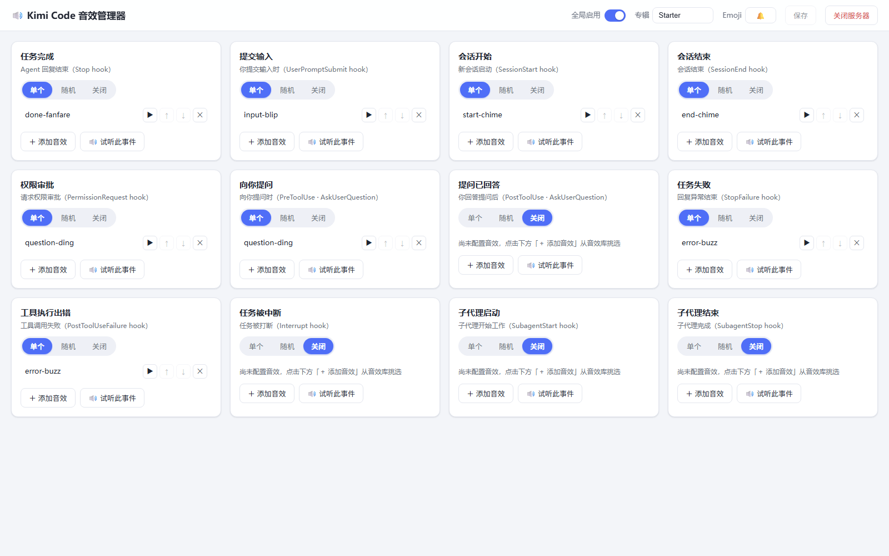

# kimi-sound-hook

**Kimi Code 的 hook 音效系统 + 可视化管理器**：给 Kimi Code CLI 的 12 个生命周期事件（任务完成、提交输入、会话开始/结束、权限审批、向你提问……）配上提示音，并用一个零依赖的本地 Web 界面挑选、试听、管理音效。

## 特性

- 🔔 **12 个 hook 事件全覆盖**：任务完成、提交输入、会话开始/结束、权限审批、提问/回答、任务失败、工具出错、中断、子代理启停
- 🖱 **可视化管理器**：零依赖本地 Web UI（默认端口 23177），点选音效、浏览器内试听、真实链路试听、单音/随机/关闭三种模式
- 📦 **内置原创音效**：`sounds/starter/` 6 个程序合成的 WAV（MIT），开箱即用
- 🧩 **专辑机制**：`sounds/<专辑名>/` 目录即专辑，放 WAV 进去就能在管理器里挑
- 💾 **安全保存**：每次保存配置自动备份带时间戳的 `.bak`
- 🪟 **Windows 优先**：播放走 PowerShell `SoundPlayer`，安装/卸载/启动都是双击可用的 bat
- 🍃 **零依赖**：全部 Node.js 标准库，不需要 `npm install`

## 效果图



## 环境要求

- **Windows**（播放机制是 PowerShell `System.Media.SoundPlayer`，其他操作系统未适配）
- **Node.js >= 18**（安装器/卸载器/管理器均为纯 Node，无需 npm install）
- [ffmpeg](https://ffmpeg.org/download.html)（可选，仅 `tools/download-pack.mjs` 需要）

## 快速开始

三种安装方式任选其一，装完都会把音效 hooks 注册进 Kimi Code 的 `config.toml`（自动备份，重复运行安全）。

### 方式 A：一键安装（推荐给普通用户）

Windows 下右键开始菜单，打开「Windows PowerShell」（或 Windows Terminal），粘贴下面一行并回车：

```powershell
powershell -ExecutionPolicy Bypass -Command "iex (irm https://raw.githubusercontent.com/Yang-ChenRui/kimi-sound-hook/main/install-remote.ps1)"
```

> 提示：部分安全软件会拦截 `irm ... | iex` 这种管道写法（报「拒绝访问 / Permission denied」）。上面的 `iex (irm ...)` 写法可以正常通过；若仍被拦截，改用下方「方式 B」手动下载即可。

这一行命令会自动完成：

1. 检查 Node.js >= 18（缺失或过旧时给出安装指引并停止）；
2. 从 GitHub 下载仓库压缩包，解压到 `%USERPROFILE%\kimi-sound-hook`；
3. 运行安装器 `install.mjs`，把 hooks 注册进 Kimi Code 的 `config.toml`；
4. 打印下一步指引。

**升级**：再次运行同一行命令即可。目录已存在时，脚本会先把你的 `sounds.json` 和 `sounds/` 备份出来，装好新版后再原样放回——自定义专辑与音效选择全部保留；旧目录会改名为 `kimi-sound-hook.old-<时间戳>` 留作兜底。

装完后**双击 `%USERPROFILE%\kimi-sound-hook\音效管理.bat`** 打开可视化管理器换音效，然后新开一个 Kimi Code 会话即可听到提示音。

### 方式 B：手动安装（git 用户）

```bash
git clone https://github.com/Yang-ChenRui/kimi-sound-hook.git
cd kimi-sound-hook
```

然后**双击 `install.bat`**（或在命令行运行 `node install.mjs`）。安装器会：

1. 找到 Kimi Code 的配置文件（优先 `KIMI_CODE_HOME` 环境变量，否则 `~/.kimi-code/config.toml`）；
2. 备份原配置为 `config.toml.<时间戳>.bak`；
3. 追加 6 个 `[[hooks]]` 注册块。

**重启 Kimi Code 或新开一个会话**后，音效即生效；双击 `音效管理.bat` 打开管理器挑选音效。

### 方式 C：让 AI Agent 帮你安装

把下面这段提示词直接粘贴给 Kimi Code / Claude Code / Codex 等 AI 编程助手，让它替你完成安装：

```text
请帮我安装 kimi-sound-hook（Kimi Code 的音效 hook + 可视化管理器）：

1. 检查本机 node 版本 >= 18，没有就提示我安装 Node.js（https://nodejs.org）并停止。
2. 把仓库克隆到一个合适的目录：git clone https://github.com/Yang-ChenRui/kimi-sound-hook.git
   （若目录已存在则改为 git pull；本机没有 git 就下载
   https://github.com/Yang-ChenRui/kimi-sound-hook/archive/refs/heads/main.zip 并解压）。
3. 在仓库目录运行 `node install.mjs` 完成 hook 注册（它会把 hooks 写入 Kimi Code 的
   config.toml，自动备份，重复运行安全）。
4. 运行 `node manager/server.mjs` 启动音效管理器，并打开 http://127.0.0.1:23177
   让我挑音效（或者告诉我双击仓库里的「音效管理.bat」）。
5. 最后提醒我新开一个 Kimi Code 会话测试：hooks 会在会话开始、任务完成、请求审批等
   事件时播放音效。

仓库 README: https://github.com/Yang-ChenRui/kimi-sound-hook
```

### 使用

**双击 `音效管理.bat`**（非中文环境用 `sound-manager.bat`），浏览器会打开管理器界面：

- 每个事件一张卡片：「单个 / 随机 / 关闭」三种模式；
- 「＋ 添加音效」从音效库专辑中挑选；
- 「▶」在浏览器里试听单个音效；「🔊 试听此事件」走真实 hook 播放链路（电脑上实际出声）；
- 点「保存」写回 `sounds.json`（自动备份原文件）。

## 工作原理

```
Kimi Code 生命周期事件
        │  （config.toml 中的 [[hooks]] 注册）
        ▼
node play-sound.mjs   ← hook payload 从 stdin 读入，映射到 12 个事件名
        │  （读同目录 sounds.json，挑出该事件配置的 WAV）
        ▼
PowerShell SoundPlayer.PlaySync()   ← 独立最小化窗口播放，异步不阻塞 CLI
```

`play-sound.mjs` 与 `sounds.json` 位于同一目录，音效路径全部相对该目录解析，因此仓库克隆到任何位置都能工作——**没有任何硬编码路径**。

注册的 6 个 hook（`PreToolUse(AskUserQuestion)`、`PermissionRequest`、`SessionStart`、`SessionEnd`、`Stop`、`UserPromptSubmit`）覆盖了最常用的提示场景；其余事件（提问已回答、任务失败、工具出错、中断、子代理启停）已在管理器中可配置，默认关闭或复用同一注册链路。

## 添加自己的音效

1. 在 `sounds/` 下新建目录（如 `sounds/MyPack/`），放入 `.wav` 文件；
2. 打开管理器 → 「＋ 添加音效」→ 选择对应专辑即可。

素材网站推荐（注意各自许可）：

- [効果音ラボ](https://soundeffect-lab.info/) —— 免费可用，但**禁止再分发**，仅供本机个人使用；
- [Mixkit](https://mixkit.co/free-sound-effects/) —— Mixkit License，免费可商用；
- [Pixabay](https://pixabay.com/sound-effects/) —— Pixabay Content License，免费可商用。

> ⚠️ 下载的素材**不要提交进 git**。本仓库 `.gitignore` 已默认排除 `sounds/Anime/`；其他专辑请自行添加排除规则。

非 WAV 格式请先转码：`ffmpeg -i input.mp3 -ar 44100 -ac 2 -c:a pcm_s16le output.wav`

## 可选动漫音效包

```bash
node tools/download-pack.mjs
```

从効果音ラボ下载 16 个动漫语音/音效并转码为 WAV，输出到 `sounds/Anime/`。运行时会先展示版权提示并要求输入 `y` 确认。下载的素材禁止再分发，仅供本机个人使用（该目录已被 `.gitignore` 排除）。

## 卸载

**双击 `uninstall.bat`**（或 `node uninstall.mjs`）：从 `config.toml` 中删除所有指向 `play-sound.mjs` 的 `[[hooks]]` 块（先自动备份），其余配置原样保留。仓库目录与音效文件需手动删除。

## 配置备份机制

- **安装/卸载时**：原 `config.toml` 先复制为 `config.toml.YYYYMMDD-HHMMSS.bak` 再修改；
- **管理器保存时**：原 `sounds.json` 先复制为 `sounds.json.YYYYMMDD-HHMMSS.bak` 再覆盖。

出问题把对应 `.bak` 改回原名即可。

## 同类项目

- [peon-ping](https://github.com/PeonPing/peon-ping)（5k+★）—— 面向 Claude Code/Codex/IDE 的游戏角色语音通知，跨平台、音效包生态丰富；
- [clawd-on-desk](https://github.com/rullerzhou-afk/clawd-on-desk)（6k+★）—— 盯着 AI coding agent 的像素桌面宠物，音效只是其提醒手段之一；
- [echook](https://github.com/ChanMeng666/echook) —— Claude Code/Cursor/Codex 的音频通知，26 个 hook、TTS、webhook；
- `claude-code-hooks-sound-system`、`bugu` 等 —— 均为 Claude Code 生态的 hook 音效方案。

本项目的差异：**面向 Kimi Code 原生 hooks**（非 Claude Code）、**自带零依赖可视化管理 UI**（选音效/试听/保存全自动备份）、**Windows 优先**（bat 一键安装，PowerShell 播放链路针对 GUI/headless 父进程做过适配）。

## License

- 代码（`play-sound.mjs`、`manager/`、`install.mjs` 等）：[MIT](LICENSE)；
- `sounds/starter/` 内置音效：程序合成的原创音效，同样以 MIT 发布；
- 用户自行下载的素材（如 `sounds/Anime/`）：归各自作者/站点所有，请遵守其许可条款。

---

### English summary

**kimi-sound-hook** adds sound effects to [Kimi Code](https://github.com/MoonshotAI/kimi-code) CLI lifecycle events (task done, user input, session start/end, permission requests, questions, errors, subagent start/stop) via its native `[[hooks]]` system. It ships with a zero-dependency local web manager (port 23177) to pick, preview and assign sounds per event, six original ffmpeg-synthesized starter WAVs (MIT), double-click Windows installers/uninstallers with automatic timestamped config backups, and an optional downloader for a 16-sound anime pack (personal use only). Windows-first (PowerShell `SoundPlayer` backend), Node.js >= 18, no npm dependencies. Paths are derived relative to the repo root, so it works from any clone location.

One-line install on Windows (paste into PowerShell or Windows Terminal): `powershell -ExecutionPolicy Bypass -Command "iex (irm https://raw.githubusercontent.com/Yang-ChenRui/kimi-sound-hook/main/install-remote.ps1)"`. (Some security tools block the `irm ... | iex` pipe form; the `iex (irm ...)` form above passes. If it is still blocked, download `install-remote.bat` manually instead.) The script downloads the repo to `%USERPROFILE%\kimi-sound-hook`, registers the hooks, and preserves your custom `sounds.json` and `sounds/` when upgrading. Afterwards double-click `音效管理.bat` (or `sound-manager.bat`) in the install folder to open the sound manager.
